<div align="center">

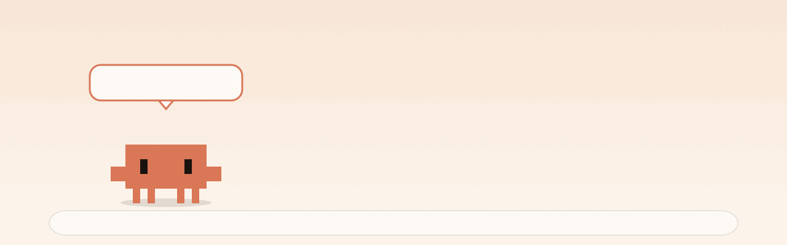

# clawd-buddy

**A tiny pixel crab that lives on your Mac.**<br>
He wanders along the bottom of your screen, says silly things, and can be dragged up into the menu bar to live there.<br>
He's also a focus timer, a file shelf, a calculator, a color picker, and he'll tell you when Claude Code is done.


**[clawd.crooli.com](https://clawd.crooli.com)**

</div>

<br>

> *Not affiliated with Anthropic. This is a fan project inspired by the little Clawd mascot from Claude Code. The art is drawn entirely in code, from rectangles.*

## Install

**Download:** grab `Clawd.zip` from the [latest release](https://github.com/xandertaylorx/clawd-buddy/releases/latest), unzip, and drag `Clawd.app` to Applications. Since it isn't notarized, right-click it and choose **Open** the first time.

**Or build it yourself.** You need macOS 14+ and the Swift toolchain (Xcode or the Command Line Tools). No Xcode project, no packages:

```bash
git clone https://github.com/xandertaylorx/clawd-buddy.git
cd clawd-buddy
./build.sh
open build/Clawd.app
```

He drops in from the top of your screen. Right-click him for the menu. The app is ad-hoc signed, so if macOS complains the first time, right-click `Clawd.app` and choose **Open**.

## He lives in the menu bar

Drag him up to the menu bar and let go. He shrinks into a status item and carries on from there: blinking, walking in place, dancing, and popping up short phrases next to his icon. **Drag him back out** of the menu bar to carry him down and drop him anywhere on the desktop, or click him for his menu and pick **Let Clawd out**.

<div align="center">
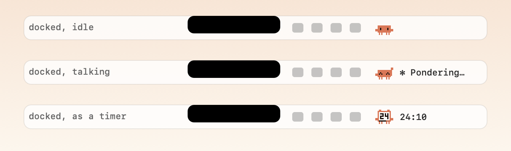
</div>

He **stays put**: reminders, timers and alerts show up as a little bubble hanging under his icon (and he animates and plays a blip), without pulling him out of the menu bar. If you'd rather he hop out to tell you, switch on **Pop out of the menu bar for alerts** under Features.

He's notch-aware: if macOS doesn't have room for his icon (a crowded menu bar next to the notch), he notices, hops back out and tells you instead of silently disappearing.

## He's a timer

Start a focus session or a break and Clawd **turns into a timer**: an alarm-clock Clawd with a pixel LCD, a draining progress bar and little bells on top. In the menu bar the same face sits in the icon with the countdown next to it. When it's done he tells you with a little bubble under his icon.

<div align="center">
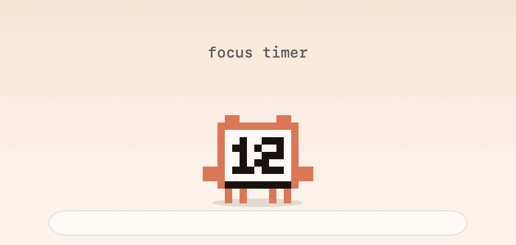
</div>

## Drag files onto him

Drag any file over Clawd and a tray of drop targets appears:

<div align="center">
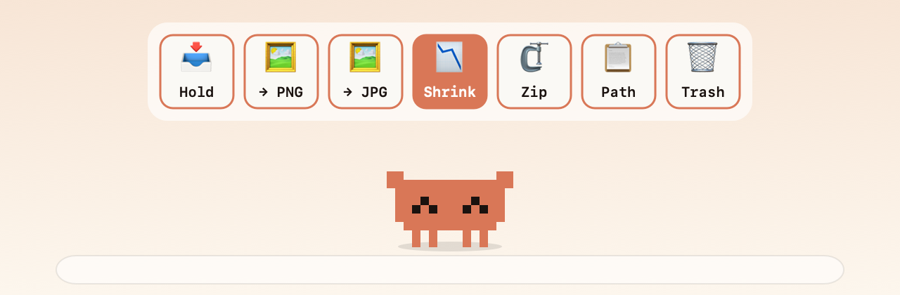
</div>

| Target | What it does |
| --- | --- |
| **Hold** | Puts the file on his shelf. Nothing is moved or copied; drag it back out whenever and wherever you like. |
| **→ PNG / → JPG** | Converts images, saving a copy next to the original. |
| **Shrink** | Compresses any image (PNG, JPEG, HEIC, TIFF, BMP, GIF, WebP…) into a smaller copy named `name-small`. JPEG and HEIC are re-encoded at the best quality that actually saves space; flat PNGs (screenshots, UI, pixel art) get a clean 256-colour palette, usually around 80% smaller; photos and gradients get a dithered palette or a JPEG, whichever is far smaller; transparency is kept; huge images are scaled to 2560px. If it can't beat the original it says so instead of leaving a bigger file. Animated GIFs are skipped. |
| **Zip** | Zips everything you dropped into one archive. |
| **Path** | Copies the file paths to your clipboard. |
| **Trash** | Moves the files to the Trash (recoverable). |

Dropping straight on him is the same as **Hold**. Dropping text saves it as a note. Drag a folder over him and the tray offers **Organise** instead of the image tools.

<div align="center">
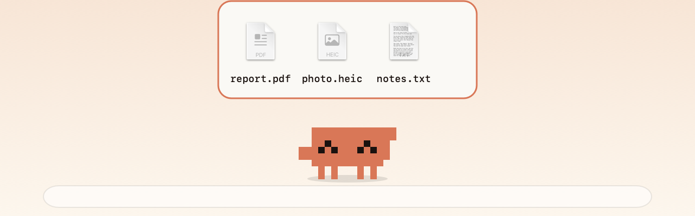
</div>

## He tidies folders

Drop **Clawd onto a Finder window** (or drag a **folder onto him** and pick the ✨ tile) and he offers to organise it. Click **Organise** and he tosses every file into the right folder, with little bins popping up and counting as they fill.

<div align="center">
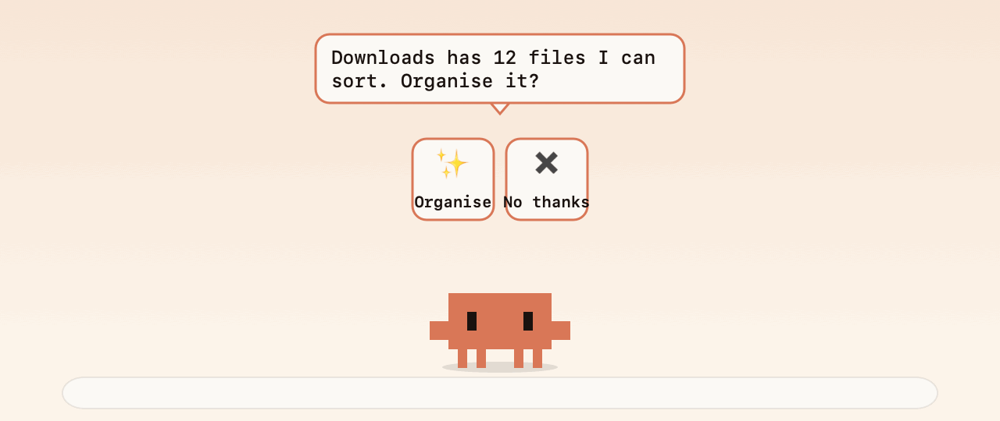
</div>

- Sorts by type: Images, Videos, Audio, Documents, Spreadsheets, Presentations, Archives, Installers, Code, Design, Books, Fonts, and Screenshots (spotted by name) on their own.
- Piles of more than 40 files in one category are split by month (`Images/2026-09`).
- **Careful by design:** he only touches loose files at the top level. Subfolders, apps, hidden files, half-downloaded files and anything you changed in the last two minutes are left alone, and he refuses code projects (a `.git`, `Package.swift`, `package.json`, Xcode project…), your home folder, and system folders.
- Nothing is ever deleted, and **Undo last organise** in his menu puts every file back and removes the folders he made.
- The first time, macOS asks whether Clawd may control Finder. That's how he learns which folder the window shows.
- From a terminal: `Clawd --organize ~/Downloads`.

## Drop a link, get an MP3 or MP4

Drag a **YouTube** or **Spotify track** link onto him and a tray appears, just like with files:

<div align="center">
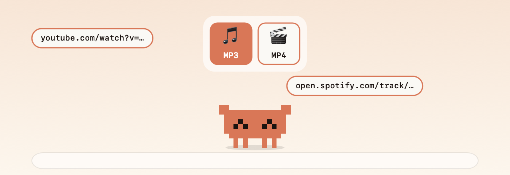
</div>

Files are saved to `~/Downloads/Clawd` and revealed in Finder, with a progress readout while he works.

- **Setup:** he uses the open-source [`yt-dlp`](https://github.com/yt-dlp/yt-dlp) and `ffmpeg`, which aren't bundled. If they're missing, he copies the install command for you: `brew install yt-dlp ffmpeg`.
- **YouTube** links give MP3 (audio) or MP4 (video).
- **Spotify** tracks give MP3. Spotify's own audio is DRM-locked, so he reads the track's title and artist from its public page and fetches the matching audio from YouTube. Quality and the match can vary.
- Only download things you have the right to keep. Check the terms of the services you use and your local copyright rules; this is a convenience wrapper and the responsibility is yours.

## Claude Code companion

Clawd watches for a busy `claude` process and tells you when a run finishes. For the moment Claude is **waiting on you** (a permission prompt, a question), add his hook: **Dev tools → Claude Code alerts (hook)…**. It merges a `Notification` hook into `~/.claude/settings.json` (backing it up first, and you can remove it the same way) that runs:

```bash
Clawd --needs-you          # reads Claude Code's message from stdin
Clawd --needs-you "text"   # or pass your own
```

He then waves and bounces, repeating until you click him or Claude starts working again, even while he's docked in the menu bar.

## Dev tools

<table>
<tr>
<td width="48%">

**GitHub dashboard** (`⌃⌥G`). Your recent repos with CI status dots, stars, open PRs and how recently they were pushed, plus PRs **waiting for your review**. Click a row to open it. It uses the [`gh` CLI](https://cli.github.com), so there's no token to paste: if `gh auth login` works, so does this. Clawd also tells you when CI fails on one of your repos or a review is requested.

**Git buddy.** Watches your local repos (he finds them for you, or add your own) and nudges you about uncommitted changes or unpushed commits after a while.

**Port watcher.** Lists what's listening on your machine (dev servers, databases) with *Open*, *Watch* and *Stop*. Watch a port and he tells you the moment it goes down or comes back.

</td>
<td width="52%">
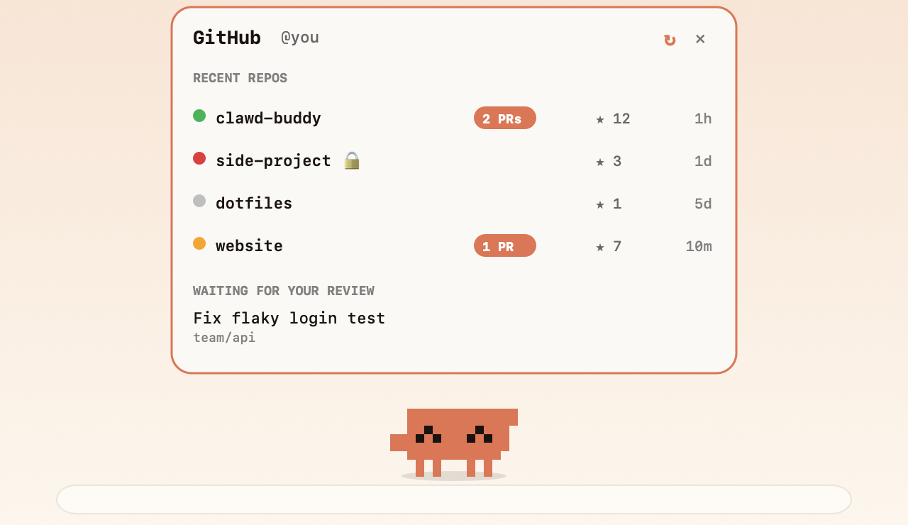
</td>
</tr>
</table>

## Weather, day and night

Set a city in his menu (it uses [Open-Meteo](https://open-meteo.com), no account) and he dresses for it:

<div align="center">
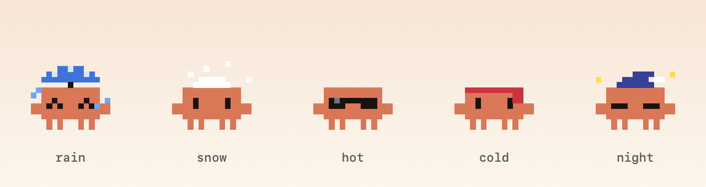
</div>

He greets you in the morning, wears a nightcap with twinkling stars after 9pm, and nudges you at bedtime (23:30, and again after midnight). Both toggle under Features.

## Flappy Clawd

A second mini-game: click (or press space) to flap Clawd through the pipes. The screen dims slightly while you play, `Esc` quits, and your best score is saved.

<div align="center">
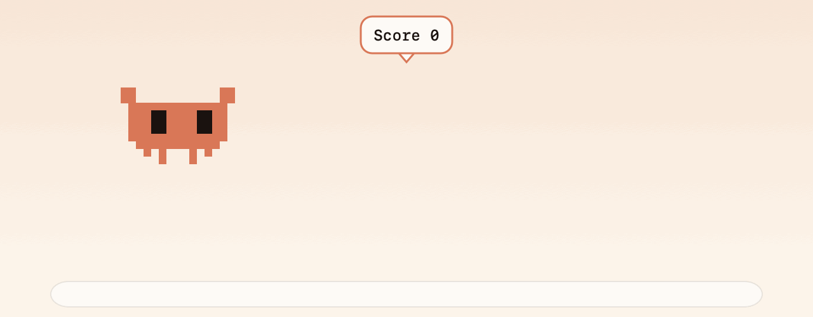
</div>

## Physics ball

Turn on **Physics ball** in his menu and Clawd curls into a ball. Grab him and **throw** him: he has gravity, bounces off the edges of your screen and off the tops of your windows, rolls and spins as he goes, and settles on the Dock looking at your cursor. Click him for a hop, double-click to unroll him.

<div align="center">
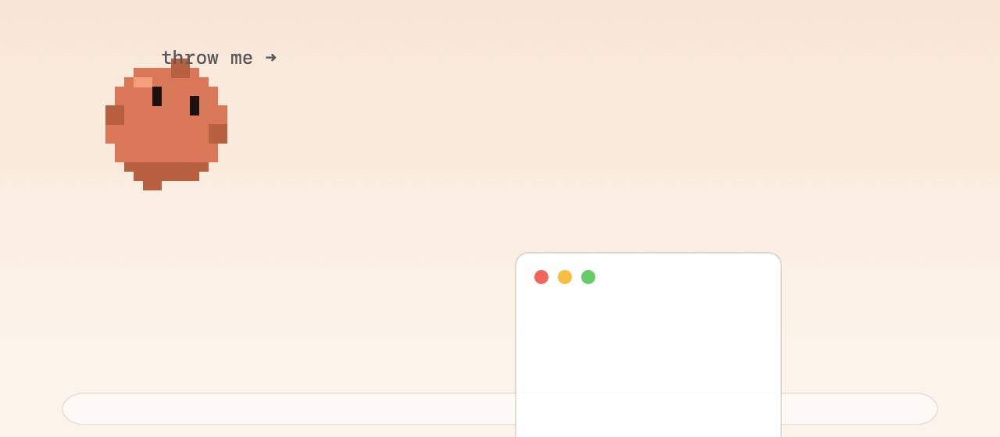
</div>

### Basketball

Pick **Play: Basketball** and he rolls into a ball while a hoop pops up on the edge of your screen. Throw him through it. **The farther the shot, the more points** (layup 1, mid-range 2, long range 3, downtown 4), and a clean **swish** that doesn't touch the rim is worth +1. The hoop moves after every basket, usually to the far side of the screen. You get 60 seconds, and your best score is saved. The rim and backboard are real obstacles, so shots can rattle in or bounce out.

<div align="center">
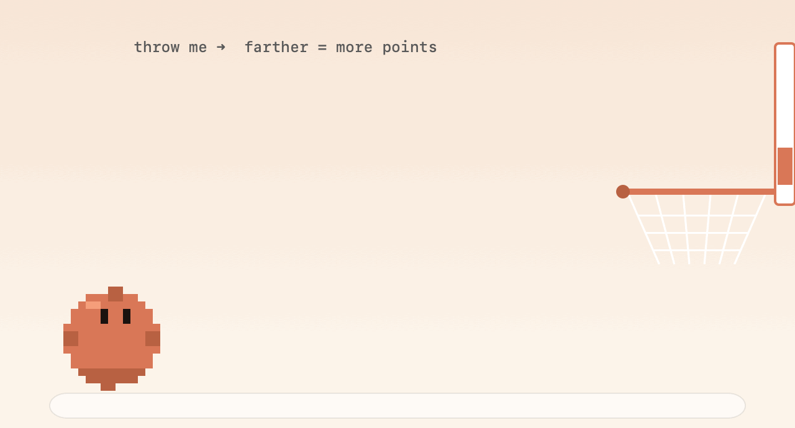
</div>

## Weird moods

Every few minutes, if you're not busy, something odd might happen: he builds **a tiny fort on top of one of your windows**, hides off the edge of the screen and **peeks back at you** (get too close and he jumps out with a "Boo!"), sneezes, or turns into a ghost. Switch them off under Features → Weird moods. Every item in the Features menu shows a tick when it's on, and he confirms each change.

<div align="center">
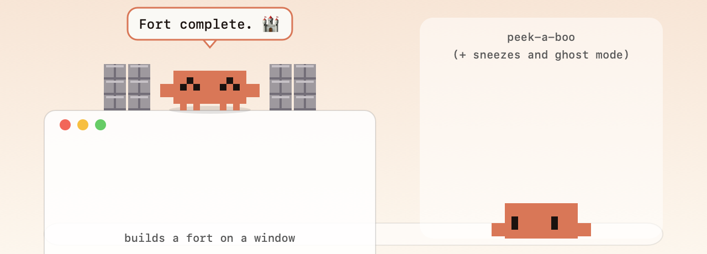
</div>

## Sounds

Everything makes a soft 8-bit blip: speaking, hopping, catching tokens, flapping, sorting files, alerts. They're synthesised on the fly (no audio files), kept quiet, and **Sounds (8-bit)** under Features mutes the lot.

## Little tools

| Tool | How |
| --- | --- |
| **Color picker**, an eyedropper for anywhere on screen. Copies the hex code. | `⌃⌥C` |
| **Ask Clawd**, a calculator that also converts units and currency: `15% of 240`, `5 ft in cm`, `72 f in c`, `40 usd to eur`, `(3+4)*2^2`, `time in tokyo` | `⌃⌥Space` |
| **Password generator** (12 / 20 / 32 characters or a PIN). Copied to the clipboard, kept out of clipboard history, and cleared after 45 seconds. | `⌃⌥P` |
| **Quick notes**, jot something down; click a note later to copy it. | `⌃⌥N` |
| **Screenshot to text (OCR)**, drag a box around anything on screen and the text lands on your clipboard. Reads it on-device with Apple's Vision framework. macOS asks for Screen Recording permission the first time. | `⌃⌥T` |
| **GitHub dashboard** | `⌃⌥G` |

Also in the menu: reminders, an in-memory clipboard history (off by default, skips passwords), calendar heads-ups, and break nudges (water, stretch, posture).

## Claude Code buddy

Clawd watches for a busy `claude` process. While Claude Code works he sits down and types, cycling through spinner words like *Flibbertigibbeting…* When it goes quiet after a real run he tells you it's finished, with a bubble under his icon if he's in the menu bar.

For "Claude needs you" moments, point a Claude Code notification hook (or any script) at his command line:

```bash
build/Clawd.app/Contents/MacOS/Clawd --say "Claude needs your attention"
npm test && build/Clawd.app/Contents/MacOS/Clawd --say "Tests passed"
```

## He plays

<table>
<tr>
<td width="50%">

**Token Catch.** A 30-second mini-game from his menu. Move your mouse to move Clawd along the bottom of the screen. Catch coins, grab rare gems, dodge the bugs. It speeds up as you go, and your best score is saved.

</td>
<td width="50%">
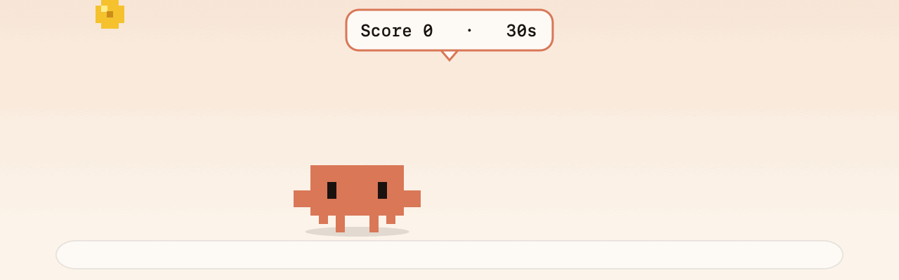
</td>
</tr>
</table>

He also climbs onto the top edge of your windows and sits there, riding along if you move them. His eyes follow your cursor, and he sometimes chases it. Hold the mouse on him to pet him. He naps when you step away, wakes when you're back, and cheers when you plug in. Click **Climb a window** in his menu to see him do it on demand.

## Dress-up

Santa in December, a pumpkin from mid-October, or pick a hat yourself under **Outfit**:

<div align="center">
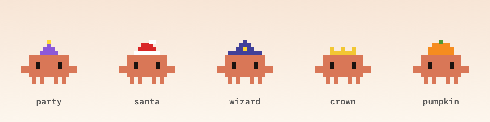
</div>

<div align="center">
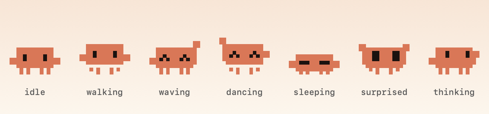
</div>

## Updates

Clawd checks this repo's latest release once a day. When a newer version is out he tells you, and an **⬆ Update to vX** item appears at the top of his menu.

<div align="center">

**click Update → he downloads the new version → swaps himself out → relaunches**

</div>

No manual download. He verifies the download is really Clawd before installing, and if he can't update himself (for example, he's in a folder he can't write to) he opens the release page instead. **Check for updates…** is in the menu too, and **Check for updates daily** under Features turns the automatic check off.

Updates come from the `Clawd.zip` on this repo's latest [release](https://github.com/xandertaylorx/clawd-buddy/releases), so you're trusting this repo, the same as when you first downloaded him. The build isn't notarized (no paid Apple Developer ID yet), so the very first launch of a fresh download still needs right-click → **Open**. Self-updates don't repeat that. If you're upgrading from v1.1.0, download v1.2.0 by hand once; it's the first version that can update itself.

## Good to know

- **Privacy.** Everything runs locally. The only network requests are the currency rate lookup for `Ask Clawd` (to `open.er-api.com`), the daily update check (to `api.github.com`), the weather lookup (`open-meteo.com`, only if you set a city), the `gh` CLI for the GitHub dashboard (only if you open it or leave the alerts on), and downloads you ask for (YouTube / Spotify's public track page). No accounts, and nothing about you is sent. The clipboard history lives in memory only. Nothing is uploaded.
- **Permissions.** Calendar heads-ups are off until you turn them on, which triggers the normal macOS Calendar prompt.
- **Quiet mode.** One toggle silences his chatter. It switches on by itself during Zoom meetings and while a focus timer runs.
- **Launch at login** is in his menu.
- **No room in the menu bar?** On notch Macs, macOS silently drops status icons that don't fit. Clawd detects this and pops back out. Hold `⌘` and drag a couple of icons off the bar to make room.
- The images in this README are rendered by the app's own drawing code (`Clawd --art docs`), not screenshots.

## How it's built

A single-purpose Swift/AppKit app with no dependencies. Clawd is drawn from filled rectangles every frame, so the same code makes the desktop sprite, the menu bar icon, the timer face and these README images.

```
Sources/main.swift   the app: sprite, behavior, menus, tools
Sources/Organizer.swift   folder organiser, Finder bridge, animation pieces
Sources/Downloader.swift  link → MP3/MP4 via yt-dlp
Sources/PetExtras.swift   drop tray logic, organise animation, downloads
Sources/Dev.swift         ports, git buddy, GitHub dashboard, Claude Code hook
Sources/Weather.swift     weather, day/night
Sources/Flappy.swift      Flappy Clawd
Sources/Moods.swift       fort, peek-a-boo, sneeze, ghost
Sources/Sfx.swift         8-bit sound synth
Sources/OCR.swift         screenshot to text
Sources/Art.swift    renders the README visuals
build.sh             compiles, makes the icon, bundles Clawd.app
website/             the landing page (static HTML/CSS/JS, with a live Clawd on it). Preview: python3 -m http.server -d website
VERSION              the version number baked into the app
.github/workflows/   builds Clawd.zip and attaches it to each release
```

## Releasing a new version

1. Change the number in `VERSION` and push.
2. Publish a GitHub release tagged `vX.Y.Z`.
3. A GitHub Action builds the app and attaches `Clawd.zip`. Everyone running an older version gets the update prompt within a day.

## Credits

Built by [Xander](https://xandertaylor.org), developed by [TIZZLE](https://tizzle.org), owned by [Crooli](https://crooli.com). The website lives at **[clawd.crooli.com](https://clawd.crooli.com)**.

## License

MIT. See [LICENSE](LICENSE).
